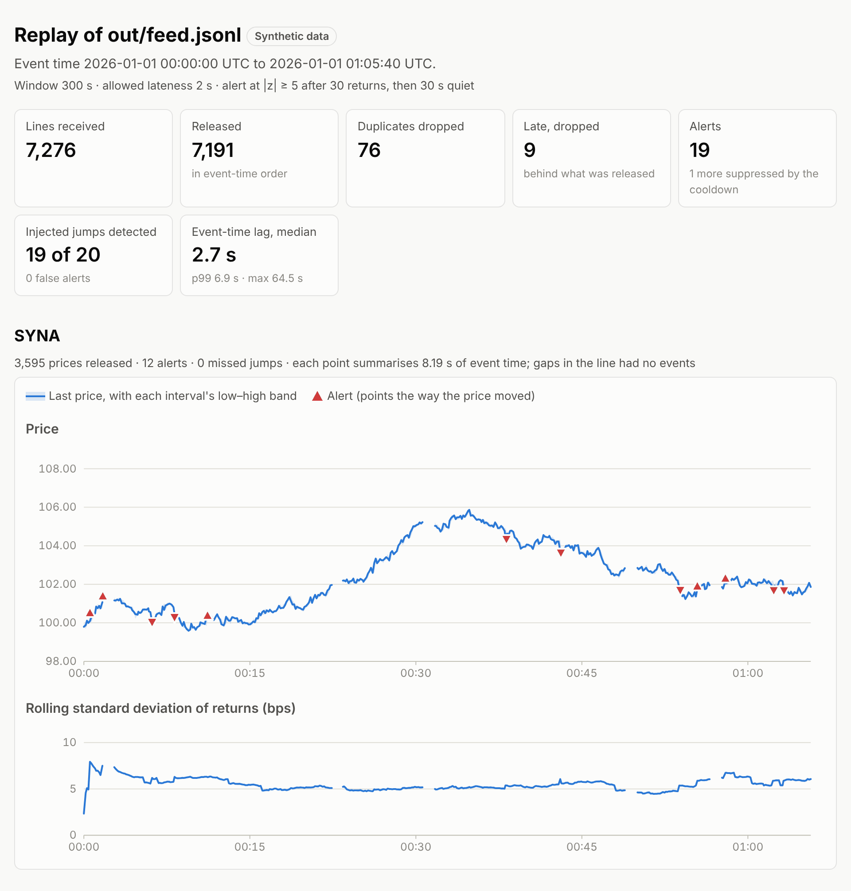
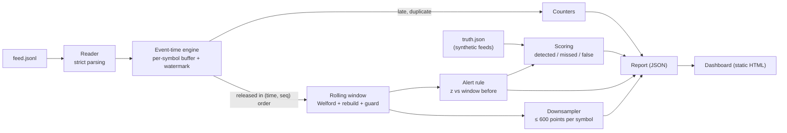

# Streaming Risk Monitor

[](https://github.com/SohamMessi10/streaming-risk-monitor/actions/workflows/tests.yml)

Replays a timestamped price feed that arrives out of order, late and duplicated. It keeps rolling
statistics per symbol over an event-time window and flags unusual returns, with the numbers
behind each one. It also proves its streaming results equal a from-scratch batch computation.
Pure Python, standard library only at runtime.



*The dashboard for the default synthetic feed. Every number on this page is measured; the feed
is synthetic, not market data.*

## The problem

A monitor watching prices has to decide, as each one arrives, whether something unusual just
happened. Three things make that harder than it looks:

1. **Events arrive out of order, late, or twice.** Statistics computed in arrival order are not
   the statistics of what happened.
2. **Running statistics drift.** Updating a variance as values enter and leave a window is fast.
   But the textbook formula loses all precision on large, close values: on 1,000 values near 10⁹
   it gives a variance of **−131.2** where the true value is 0.989.
3. **"Unusual" isn't "wrong".** An alert should say what it saw and how often the rule fires on
   noise.

## What it does

- **Event time with a watermark.**
  - Each symbol's events wait in a buffer and are released in (time, seq) order once they are
    strictly before the watermark (the latest event time minus the allowed lateness).
  - Late events and duplicates are dropped and counted, never silently merged.
  - **The guarantee:** for any arrival order whose delays stay within the lateness, the output is
    identical, float for float, to the output on the sorted feed. A Hypothesis property test
    checks it.
- **Rolling statistics that stay accurate.**
  - Welford's method, with removal, over a sliding event-time window, plus an exact rebuild every
    1,000 removals.
  - A residue guard stops equal values reporting a variance of 10⁻²⁸ instead of 0. Hypothesis
    found that case, and left alone it would turn small returns into z-scores in the millions.
  - Streaming equals a from-scratch reference (corrected two-pass with exact summation) after
    every value, at scales from returns to 10⁹.
- **Alerts with their evidence.**
  - An alert fires at |z| ≥ 5 against the window *before* the return, after 30 returns, with a
    30 s cooldown.
  - Each alert records the return, mean, standard deviation, z and window size.
- **Scoring against what was injected.**
  - The synthetic feed generator writes a truth file of every jump, duplicate, delay and gap it
    injected.
  - The replay scores each jump as detected or missed, with the reason, and each alert as a hit
    or a false alert.
- **A static dashboard.**
  - One self-contained HTML file: inline SVG, no JavaScript, and a Content-Security-Policy that
    forbids scripts and network loads.
  - It has a phone layout and dark mode.
  - Chart memory is bounded however long the feed.

## Results

Every number here was measured on seeded synthetic feeds. The scripts that reproduce them are
named below, and the full write-ups are in [`docs/`](docs).

**The default feed** (2 symbols, 7,276 lines), against its truth file:

| | Replay | Truth file |
|---|---|---|
| Duplicates dropped | 76 | 76 injected |
| Late events dropped | 9 | the 9 delayed beyond the 2 s lateness |
| Injected jumps detected | 19 of 20 | the miss: two jumps 21 s apart, inside the cooldown |
| False alerts | 0 | |
| Event-time lag | median 2.7 s, p99 6.9 s | the cost of waiting 2 s for late events |

**False alerts measured against exact theory** (`scripts/alert_quality.py`, about 2 million
returns with no jumps).

With a standard deviation estimated from n returns, a new return's z is Student's t with n − 1
degrees of freedom, times √(1 + 1/n). The textbook normal tail undercounts:

| \|z\| ≥ | false alerts | expected (exact t) | normal tail |
|---|---|---|---|
| 4.0 | 178 | 168.0 | 126.5 |
| 4.5 | 20 | 20.9 | 13.6 |
| 5.0 | 1 | 2.2 | 1.1 |

**A finding.** When a late event is dropped, the next return spans two random-walk steps and is
√2 times wider. Those returns are only 0.19% of the total, yet they caused 3 of the 5 false alerts
at |z| ≥ 5 in the run with late events. See [`docs/alerts.md`](docs/alerts.md).

**Detection by jump size** (2,106 injected jumps per size):

| jump | 3σ | 4σ | 5σ | 6σ | 8σ |
|---|---|---|---|---|---|
| detected | 0% | 0% | 34.5% | 93.4% | 94.0% |

From 6σ up, almost all misses are the cooldown (about 5%) or jumps within a symbol's first 30
returns.

**Numerics** (`scripts/numerics.py`, [`docs/numerics.md`](docs/numerics.md)):
- Over a million updates, periodic rebuilds cut Welford's drift 20 to 40 times, for about 10% more
  time.
- The residue guard costs nothing for returns (1.85 µs per update).

**Throughput and memory**, single-threaded on a 2-vCPU cloud container with Python 3.13:
- about 145k events/s in memory for the engine, alerts and chart series;
- about 69k events/s for `riskmon replay` from a 200,000-line file, strict parsing included;
- peak traced memory (`tracemalloc`) of 3.4 MiB at 200,000 lines and 5.0 MiB at 1,000,000 lines.
  Memory grows only with the number of alerts and injected jumps, not with the feed.

The speed figures are machine-dependent; on this shared container they varied by about 10% from
run to run.

## Quickstart

Needs Python 3.12 or later.

```bash
git clone https://github.com/SohamMessi10/streaming-risk-monitor.git
cd streaming-risk-monitor
python -m venv .venv && source .venv/bin/activate
python -m pip install -e ".[dev]"

riskmon generate out/feed.jsonl                       # a synthetic feed and its truth file
riskmon replay out/feed.jsonl --report out/report.json --dashboard out/dashboard.html
open out/dashboard.html                               # or xdg-open on Linux
```

Run the tests and reproduce the measurements:

```bash
python -m pytest                          # 183 tests
python -m ruff check src tests scripts
python scripts/numerics.py                # docs/numerics.md
python scripts/alert_quality.py --quick   # docs/alerts.md (without --quick: the full run, minutes)
```

## Commands

| Command | What it does |
|---|---|
| `riskmon generate OUT [--symbols A,B] [--seed N] [--events N] [--jump-rate R] [--duplicate-rate R] [--late-rate R]` | Writes a seeded synthetic feed and `OUT`'s `.truth.json`. The same options give the same file byte for byte. |
| `riskmon replay FEED [--report R.json] [--dashboard D.html] [--truth T \| --no-truth] [--window-ms] [--lateness-ms] [--threshold] [--min-count] [--cooldown-ms]` | Replays a feed and prints a summary. A truth file next to the feed is used automatically. |
| `riskmon dashboard REPORT OUT` | Renders a saved report: the same page as `replay --dashboard`. |

Exit codes: 0 done, 1 something couldn't be read or written (the message names the file and,
for a feed, the line), 2 bad options.

**The feed format** is JSON Lines, one event per line:

```json
{"symbol": "SYNA", "time": 1767225600000, "seq": 0, "price": 100.0}
```

- `time` is integer milliseconds of event time, which keeps window edges exact.
- `seq` is the symbol's sequence number; a repeated (symbol, seq) is a duplicate.
- Parsing is strict: an unknown or missing field, a wrong type or a bad value stops the read,
  naming the line.

## Architecture



| Module | Role |
|---|---|
| `events.py` | Feed format and strict, lazy reader |
| `generate.py` | Seeded synthetic feed and its truth file |
| `window.py` | Rolling statistics (Welford, rebuilds, residue guard) and the batch reference |
| `engine.py` | Event time: reorder buffer, watermark, late and duplicate handling |
| `alerts.py` | The alert rule |
| `replay.py` | Engine, alerts and scoring together; the report |
| `series.py` | Bounded downsampling for charts |
| `dashboard.py` | The static HTML dashboard |
| `cli.py` | The `riskmon` command |

## How correctness is checked

- **Streaming equals batch.** Hypothesis generates random feeds; the streaming statistics must
  match a from-scratch reference after every value, at seven scales from returns to 10⁹. The
  tolerance is relative to the largest value that has been in the window, and equal values must
  give exactly 0.
- **Arrival order doesn't matter within the lateness.** Any shuffle whose delays stay within it
  gives identical output and identical alerts.
- **Exact counts.** On generated feeds, duplicates and late events match the truth file.
- **Mutation testing.** Each milestone planted deliberate bugs, 92 in all, and checked the tests
  caught them.
  - The 13 that survived because of test gaps each have a new test now. One of those gaps hid a
    real bug: an off-by-one p99.
  - The rest changed nothing observable, and are explained in [`PROGRESS.md`](PROGRESS.md).
- **CI:** lint and the full suite on Python 3.12, 3.13 and 3.14 (Ubuntu) and 3.13 (macOS), with
  Hypothesis trying 1,000 cases per property. Every commit is tested on its own before merging.
- **The dashboard** is checked in Chromium at desktop and phone widths, in light and dark mode, for
  console errors and sideways scrolling, and its colours pass a colour-blind-safety validator.

## Design decisions

- **Integer milliseconds,** so no float rounding decides whether an event is in a window.
- **Release strictly before the watermark.** Releasing *at* it could put out a same-time event
  with a higher seq before a lower one, delayed by exactly the lateness, arrived. A test pins
  this.
- **Remember duplicates for one window of event time.** Forgetting a sequence number when its
  event is released would count a quick duplicate as late. Remembering it longer would let memory
  grow.
- **z against the window before the return.** A jump added first widens the window and partly
  hides itself.
- **Count lags instead of storing them.** Median and p99 come out exact from a count per distinct
  millisecond, and memory stays bounded.
- **No NumPy and no web framework.** Every computation is per event, and the dashboard is a file
  you can attach or archive.

## Limitations

- **Synthetic data.** The alert results show the rule finds what was injected and fires falsely
  as often as theory predicts for normal returns. Real returns have fatter tails, so expect more
  false alerts on them.
- **Idle watermarks.** A symbol's watermark moves only when it has a new event, so after a gap its
  last events wait; the default feed's 60 s gaps give lags up to 64.5 s. Production systems
  advance idle watermarks by wall-clock time.
- **Returns that span a dropped event** are √2 wider and cause most false alerts in the far tail.
  Normalizing returns by elapsed time, or flagging such alerts, would fix it.
- **One process, no persistence.** A replay is a batch over a file, not a service, and state isn't
  saved between runs.

## More

- [`docs/design.md`](docs/design.md): the design, scope and event-time rules.
- [`docs/numerics.md`](docs/numerics.md): accuracy of the rolling statistics, measured.
- [`docs/alerts.md`](docs/alerts.md): false alerts against theory, and detection by jump size.
- [`PROGRESS.md`](PROGRESS.md): what each milestone built, measured and fixed.

MIT licensed.
